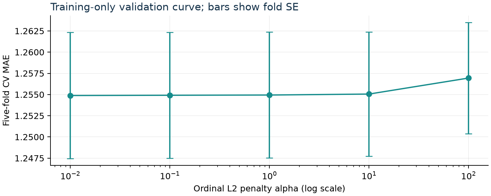

# Model Development Report - Part 2: Training and Tuning | Objectives, validation and uncertainty

## 1. Training results: validation inside training only

EVS subset: 59,438 respondents / 36 countries; A170 has 59,122 valid responses. The fixed split yields 34,740 training, 5,007 production-validation, 10,079 same-country final-test and 9,296 held-out-country final-test cases. The 316 missing targets are excluded from predictive learning. Counts differ slightly from nominal percentages due to per-stratum rounding.

Held-out countries: AT, FR, GB, LT, MK, RS. Neither final prediction test was used for tuning or model comparison. Five within-country folds share country contexts but not respondents; five group folds remove entire training-country contexts.

| Approach | Criterion | Fitted summary | Chosen tuning | Optimizer | CV MAE +/- SE Log loss RPS |

|---|---|---|---|---|---|

| baseline | Empirical absolute loss / frequencies | median 8; P(7-10)=0.726 | None | Closed form | 1.565 +/- 0.009 1.999 0.1251 |

| ordinal | Threshold logistic + L2 | 81 coefficients + 9 cutpoints | alpha=0.01 | L-BFGS-B; analytic gradient | 1.255 +/- 0.007 1.802 0.1001 |

| forest | Gini split gain | 200 trees | depth 14; leaf 10; mtry 0.7 | Greedy CART; seed 42 | 1.250 +/- 0.005 1.753 0.0987 |

| boosting | Multiclass log loss | 780 trees | lr 0.1; leaves 15; leaf 50; L2 1.0 | Histogram boosting; early stop | 1.225 +/- 0.006 1.715 0.0963 |

| inference | Weighted ratio | p=0.712; SE=0.0030 | No tuning; 1,000 bootstrap draws | Closed form; seed 42 | N/A |

| causality | Not identified | Effect N/A; SE N/A | N/A: new design needed | Not fitted | N/A |

<b>Frozen selection:</b> boosting; rule: lowest mean CV MAE. MAE uses the median of the predicted 10-category distribution. SE is the sample SD of five fold MAEs divided by sqrt(5): a descriptive tuning uncertainty, not a survey-design or independent-fold confidence interval.

## 2. Criteria and representation

Ordinal fitting minimizes all-threshold logistic surrogate loss plus L2; the baseline uses observed frequencies. Forests greedily improve Gini impurity; histogram boosting minimizes multinomial log loss. Final selection instead targets CV MAE; log loss and RPS check probability quality. No class balancing is applied, because it would change the learned prevalence. All predictive fitting is unweighted; survey-weighted inference answers a separate population question.

Age and age squared use fold-specific median imputation and scaling; a missing-age indicator is added. Nominal and ordinal survey items use explicit categories, including missingness. Country holdouts receive unknown-country indicator blocks during group CV; the public command rejects unsupported countries. The production artifact contains only 30 training-country contexts.

## 3. Alternative training criterion: squared versus Huber loss

| Same numeric linear specification | CV MAE | CV MSE |

|---|---|---|

| OLS: half squared residual | 1.2837 | 2.9393 |

| Huber: delta fixed at 1 point | 1.2731 | 2.9776 |

This audit supplement changes the global fitting loss, keeping the same unpenalized linear function class, training folds and support clipping (1-10). Squared loss targets a conditional mean; Huber limits tail influence and targets a robust centre. Numeric score distances are an explicit auxiliary assumption. Mean absolute OOF prediction change is 0.149 points (95th percentile 0.429). No test/production data or model reselection is involved.

## 4. Search, chosen hyperparameters and sensitivity

Search methods: grid for ordinal alpha {0.1,1,10,100}; grid for forest depth {6,10} x minimum leaf {20,50} x max_features {sqrt,0.7}, with 200 trees; eight seeded random boosting configurations from learning_rate {0.05,0.1}, leaves {7,15}, minimum leaf {50,100}, L2 {0,1}. One boundary extension tried ordinal 0.01, forest depth 14/leaf 10 and boosting leaves 23/leaf 25. Selected settings are in the training table. Five identical folds refit all preprocessing; full trial values/timings are saved.

Boosting caps iterations at 200, uses 15% internal training-fold validation, patience 15, tol=1e-7 and seed 42. Additional audit diagnostics use three seeds and the same already-frozen configurations; they do not tune against production validation.

| Frozen selected-family specification | CV MAE | Log loss | RPS |

|---|---|---|---|

| demographic_economic | 1.447 | 1.892 | 0.1140 |

| with_happiness | 1.102 | 1.625 | 0.0870 |

| demographics_only | 1.470 | 1.909 | 0.1160 |

Sensitivity fits reuse the selected family's hyperparameters without retuning; differences assess predictor availability, not separately optimized competitors. Adding happiness tests near-proxy dependence; removing subjective inputs tests whether survey-like subjective answers are essential.

## 5. Optimization and fitted parameters

<b>Ordinal:</b> L-BFGS-B with analytic gradients, ordered-threshold increment constraints, initial slopes zero and cutpoints empirical cumulative logits; 2,000 initial iterations, ftol=1e-9, gtol=1e-5; retry at stricter tolerance when necessary. Final fit: 135 iterations; success=True; objective 100772.10; projected gradient per training row 2.8e-05. <b>Boosting:</b> final fit 78 iterations / 780 trees; internal validation log loss 1.9991 to 1.7282. Alternate-seed details are recorded in seed_stability.json.

<b>Fitted ordinal parameters:</b> largest absolute coefficients A009_5=-1.530; A173_10=+1.457; A009_1=+1.324; nine cutpoints [-3.77, -3.24, -2.55, -1.97, -0.98, -0.30, 0.68, 2.00, 3.07]. <b>Huber:</b> rank 73, start=OLS, L-BFGS-B, delta=1, maxiter=3000, ftol=1e-12, gtol=1e-7; 310 iterations, objective 0.8636, max gradient 2.5e-07; success=True. OLS is a closed-form rank-revealing least-squares solve. Both objectives are convex; multiple local starts are unnecessary.

<b>Seeds 42/2026/2027:</b> forest: CV MAE 1.2490-1.2514; full-training log loss best 1.5243, range 0.0009; boosting: CV MAE 1.2244-1.2286; full-training log loss best 1.6144, range 0.0053. These are stability checks of greedy randomized procedures, not a global optimum claim; no new model was selected.

<b>Define continuity checks:</b> the strictly demographic benchmark uses sex, age, education and country, excluding income/employment. All 30 training countries have OOF reliability bins in calibration_country_cv.csv (sparse bins flagged). The income gap is 34.24 pp at scores 7-10 and 34.75 pp at 8-10; the paid-work gap is 18.67 and 15.44 pp respectively. Weighted medians are 8 versus 7 for high/low income and 8 versus 7 for paid work/unemployment. The directions persist, not the gap sizes. Full 1-10 group distributions and threshold summaries are saved; these are descriptive training diagnostics, not new uncertainty or causal estimates.

Software/functions: custom OrdinalLogit.objective with scipy.optimize.minimize; sklearn.ensemble.RandomForestClassifier / HistGradientBoostingClassifier; scipy.linalg.lstsq and minimize for the criterion supplement. Complete defaults/non-defaults and fitted parameter arrays are saved as JSON. Greedy trees have no interchangeable continuous solver or global convergence certificate.

## 6. Transfer diagnostics and uncertainty

| Frozen candidate | Grouped CV MAE | Log loss | RPS |

|---|---|---|---|

| baseline | 1.565 | 2.003 | 0.1254 |

| ordinal | 1.282 | 1.822 | 0.1022 |

| forest | 1.281 | 1.782 | 0.1008 |

| boosting | 1.266 | 1.760 | 0.0997 |

Group CV is a secondary training-country diagnostic, not nested CV or a score on the six held-out test countries: configurations were chosen using within-country CV across the training sample. It exposes transfer to unfamiliar country indicator blocks. Country/subgroup errors and reliability bins are provided as aggregates. Predicted category probabilities express model uncertainty; no individual prediction intervals are claimed.

## 7. Population estimates and descriptive gaps

| Overall weighting | High-satisfaction proportion | Approx. SE | Approx. 95% interval |

|---|---|---|---|

| unweighted | 72.57% | 0.22 pp | 72.16-73.01% |

| equal_country | 71.18% | 0.30 pp | 70.60-71.77% |

| population | 67.14% | 0.64 pp | 65.94-68.42% |

| Descriptive contrast | Difference | Approx. SE | Approx. 95% interval |

|---|---|---|---|

| income high minus low | +34.24 pp | 0.99 pp | +32.18 to +36.13 pp |

| paid minus unemployed | +18.67 pp | 1.25 pp | +16.22 to +21.22 pp |

Revised from Define: these estimates fit only the 34,740 training respondents in 30 countries. Analysis weights are gwght / pi, correcting the country x outcome partition retention (pi=0.5-0.7); pooled size factors define different summaries. Bootstrap intervals use 1,000 iid respondent resamples within fixed countries and fixed weights. They are approximate: national PSU dependence, target/income nonresponse and measurement bias remain. No inference to the six held-out countries is made. Groups with raw or effective n below 30 are suppressed.

Income is missing in 14.70% of the original EVS subset. For the revised training-country inference, size-weighted high-satisfaction proportions are 70.85% with observed income and 72.89% with missing income. This diagnoses a potentially selected complete-case population; it does not identify an MNAR correction.

## 8. Causality, reproducibility and remaining evaluation

<b>Causal estimate: N/A; causal standard error: N/A.</b> EVS has no baseline employment transition or 12-month outcome and cannot identify the intervention. The paid-work gap above is an association with a descriptive standard error, not a substitute causal estimate. A new longitudinal/experimental design is required; no estimator can repair absent identification.

Environment: Python 3.12.14; scikit-learn 1.9.1; NumPy 2.5.4; SciPy 1.18.1. Seed 42. Input Parquet SHA-256: 978592d03407591d74b1... Full source/code hashes, package versions, split policy and optimizer settings are recorded. Source: EVS/WVS ZA7505 v5.0.0, doi:10.4232/1.14320. Reproduce with make train, make inference and make develop-reports.
